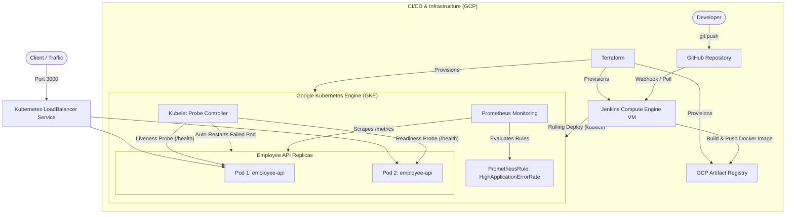
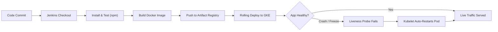

# Self-Healing Cloud & DevOps Platform

A resilient, automated cloud platform built on **Google Cloud Platform (GCP)** featuring automated CI/CD pipelines, Kubernetes container orchestration with self-healing capabilities, real-time observability, and Infrastructure as Code (IaC).

---

## Table of Contents

- [Overview](#-overview)
- [System Architecture](#-system-architecture)
- [CI/CD & Self-Healing Workflow](#-cicd--self-healing-workflow)
- [Key Features](#-key-features)
- [Tech Stack](#-tech-stack)
- [Project Structure](#-project-structure)
- [Getting Started](#-getting-started)
  - [1. Infrastructure Provisioning (Terraform)](#1-infrastructure-provisioning-terraform)
  - [2. Accessing Jenkins CI/CD](#2-accessing-jenkins-cicd)
  - [3. Application Deployment (Kubernetes)](#3-application-deployment-kubernetes)
  - [4. Monitoring & Alerting (Prometheus)](#4-monitoring--alerting-prometheus)
- [Testing Self-Healing & Endpoints](#-testing-self-healing--endpoints)

---

## Overview

This project implements an end-to-end production-grade DevOps lifecycle for a microservice API (`employee-api`):
1. **Infrastructure as Code (Terraform)** provisions a Google Kubernetes Engine (GKE) cluster, Artifact Registry, IAM roles, and a dedicated Jenkins compute instance.
2. **Automated CI/CD (Jenkins)** builds, tests, containerizes, pushes images, and rolls out updates to GKE with zero downtime.
3. **Self-Healing Architecture (Kubernetes)** uses configured Liveness and Readiness probes to automatically detect unhealthy containers and restart or isolate them without human intervention.
4. **Observability (Prometheus & Metrics)** collects request rate, duration, and error metrics, triggering alerts when error thresholds are exceeded.

---

## System Architecture



---

## CI/CD & Self-Healing Workflow



---

## Key Features

- **Automated Infrastructure Provisioning:** Complete GCP cloud footprint (VPC network, firewall rules, GKE cluster, Node Pools, VM instance, IAM policies) deployed via reusable Terraform modules.
- **Zero-Downtime Rolling Deployments:** Jenkins pipeline triggers rolling image updates on GKE, verifying rollout status before completing.
- **Active Self-Healing:**
  - **Liveness Probes:** Regularly checks `/health`. Unresponsive or deadlocked containers are killed and restarted automatically.
  - **Readiness Probes:** Prevents traffic routing to instances during startup or when failing downstream checks.
- **Microservices Observability:** Integrated `prom-client` in Node.js exposing custom HTTP metrics (`http_request_total`, `http_request_duration_seconds`) on `/metrics`.
- **Automated SRE Alerting:** Pre-configured `PrometheusRule` alerting when API 5xx errors exceed 5% over a 2-minute rolling window.

---

## Tech Stack

| Domain | Technology |
|---|---|
| **Cloud Provider** | Google Cloud Platform (GCP) |
| **Infrastructure as Code** | Terraform |
| **Container Orchestration** | Kubernetes / Google Kubernetes Engine (GKE) |
| **CI/CD Automation** | Jenkins Pipeline (Groovy) |
| **Containerization** | Docker, GCP Artifact Registry |
| **Monitoring & Alerting** | Prometheus, CoreOS Prometheus Operator |
| **Application Layer** | Node.js, Express.js |

---

## Project Structure

```text
self-healing-platform/
├── Jenkinsfile                 # Declarative CI/CD pipeline definition
├── app/
│   ├── Dockerfile              # Multi-stage lightweight Node Alpine container build
│   ├── package.json            # Application dependencies and scripts
│   └── server.js               # Express microservice with Prometheus instrumentation
├── k8s/
│   ├── deployment.yaml         # Kubernetes deployment with self-healing probes
│   ├── service.yaml            # LoadBalancer service configuration
│   └── alerts.yaml             # PrometheusRule alerting on high error rate
└── terraform/
    ├── main.tf                 # GKE cluster, Jenkins VM, firewall, and IAM definitions
    ├── outputs.tf              # Cloud outputs (Jenkins IP, GKE cluster name, etc.)
    ├── variables.tf            # Configurable Terraform input variables
    └── terraform.tfvars        # Environment-specific configuration
```

---

## Getting Started

### Prerequisites

- [Terraform](https://developer.hashicorp.com/terraform/downloads) (>= 1.5.0)
- [Google Cloud SDK (`gcloud`)](https://cloud.google.com/sdk/docs/install)
- [kubectl](https://kubernetes.io/docs/tasks/tools/)
- Active GCP Project with Compute Engine and Kubernetes Engine APIs enabled

---

### 1. Infrastructure Provisioning (Terraform)

1. Authenticate with Google Cloud:
   ```bash
   gcloud auth login
   gcloud auth application-default login
   ```

2. Initialize and deploy infrastructure:
   ```bash
   cd terraform
   terraform init
   terraform plan
   terraform apply
   ```

3. Note down the outputs:
   ```bash
   terraform output jenkins_external_ip
   terraform output cluster_name
   ```

---

### 2. Accessing Jenkins CI/CD

1. Open your browser and navigate to:
   ```text
   http://<YOUR_JENKINS_EXTERNAL_IP>:8080
   ```
2. Log in with your admin credentials.
3. Configure the pipeline job pointing to your GitHub repository and trigger the build. The pipeline will:
   - Run tests (`npm test`)
   - Build container image
   - Push to Artifact Registry
   - Execute rolling deployment on GKE

---

### 3. Application Deployment (Kubernetes)

Connect to the GKE cluster:
```bash
gcloud container clusters get-credentials self-healing-cluster \
  --zone asia-south1-a \
  --project <YOUR_GCP_PROJECT_ID>
```

Apply deployment and service manifests:
```bash
kubectl apply -f k8s/deployment.yaml
kubectl apply -f k8s/service.yaml
```

Check the status of pods and external service IP:
```bash
kubectl get pods
kubectl get svc employee-api
```

---

### 4. Monitoring & Alerting (Prometheus)

Apply Prometheus alerting rules:
```bash
kubectl apply -f k8s/alerts.yaml
```

Inspect active Prometheus rules:
```bash
kubectl get prometheusrule -n monitoring
```

---

## Testing Self-Healing & Endpoints

### 1. Verify Application Endpoints
```bash
# Health check endpoint used by Kubernetes probes
curl http://<EXTERNAL_IP>:3000/health

# Application data endpoint
curl http://<EXTERNAL_IP>:3000/api/employees

# Prometheus metrics endpoint
curl http://<EXTERNAL_IP>:3000/metrics
```

### 2. Simulate Container Failure to Test Self-Healing
Manually kill the primary Node.js process inside a running pod to observe Kubernetes automatically restarting it:
```bash
# Find pod name
kubectl get pods -l app=employee-api

# Kill process in container
kubectl exec -it <POD_NAME> -- kill 1

# Watch the self-healing restart
kubectl get pods -l app=employee-api -w
```
You will observe the restart count increment, and the pod will be restored to running state within seconds with zero downtime to end users.
